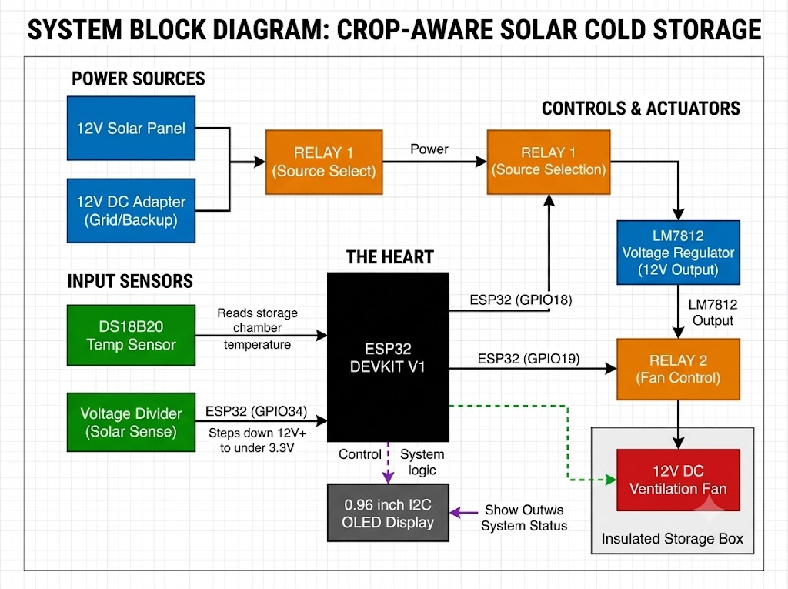
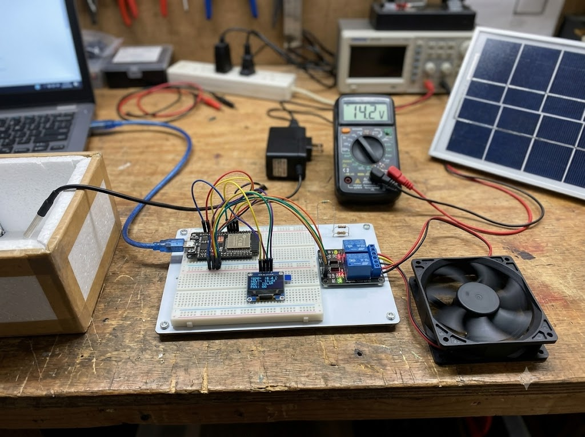
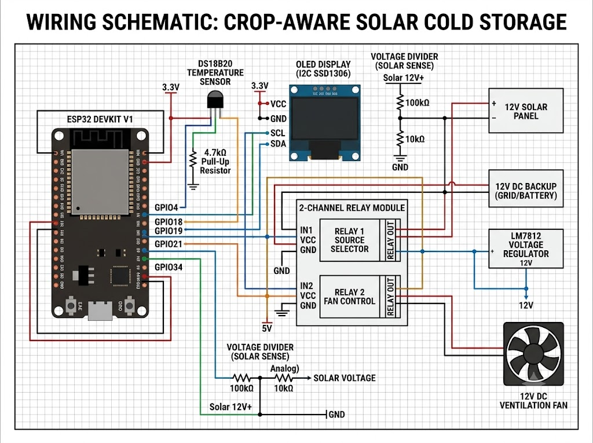

# Crop-Aware Predictive Solar Cold Storage System using ESP32

An ESP32-based micro-cold storage management system designed to help smallholder farmers reduce post-harvest crop losses by maintaining crop-specific environmental conditions using solar power.

---

## 📌 System Overview & Diagrams

The system monitors storage chamber temperature and available solar panel voltage, automatically routing power between the solar PV system and grid backup, while maintaining optimal cooling conditions.

### System Architecture

### Hardware Setup

---

## ⚡ Key Features

- **DS18B20 Temperature Monitoring:** Continuously tracks temperature inside the storage chamber.
- **Solar Panel Voltage Sensing:** Reads solar panel voltage via GPIO34 (using a voltage divider).
- **Smart Source Selection (Relay 1):** Automatically toggles between Solar PV and 12V Grid/Adapter backup based on panel voltage.
- **Temperature & Ventilation Control (Relay 2):** Regulates the cooling fan with built-in hysteresis to prevent rapid switching.
- **OLED Display Output:** Displays real-time status of voltage, temperature, selected power source, and fan status.

---

## 🛠️ Hardware Requirements

- **Microcontroller:** ESP32 Development Board
- **Temperature Sensor:** DS18B20 Probe (with 4.7kΩ pull-up resistor)
- **Voltage Measurement:** Resistor Voltage Divider connected to GPIO34
- **Power Switching:** 2-Channel 5V Relay Module
- **Display:** 0.96-inch I2C OLED Display (SSD1306)
- **Power Supply:** 12V Solar Panel, 12V DC Adapter/Grid Supply, LM7812 Voltage Regulator

---

## 🔌 Circuit & Wiring Schematic

### Pin Connections

| Component / Function | ESP32 Pin |
| :--- | :--- |
| DS18B20 Data Line | GPIO 4 |
| Solar Voltage Sense | GPIO 34 (Analog) |
| Relay 1 (Source Select) | GPIO 18 |
| Relay 2 (Fan Control) | GPIO 19 |
| OLED SDA | GPIO 21 |
| OLED SCL | GPIO 22 |

---

## 💻 Software & Required Libraries

Make sure to install the following libraries in Arduino IDE before compiling:
- `Adafruit SSD1306`
- `Adafruit GFX`
- `OneWire`
- `DallasTemperature`

---

## 🔧 Troubleshooting Guide

### 1. Solar Panel Voltage Reading Issues
- **Problem:** Reading 0V or fluctuating incorrect voltage on GPIO34.
- **Fix:** ESP32 GPIOs can only accept a maximum of **3.3V**. Ensure you are using a voltage divider circuit (e.g., 100kΩ and 10kΩ resistors) to scale down panel voltage (up to 25V) to under 3.3V before connecting to GPIO34.

### 2. DS18B20 Temperature Sensor Reading `-127°C` or `85°C`
- **`-127°C`:** Indicates no communication. Check wiring and ensure a **4.7kΩ pull-up resistor** is connected between Data (GPIO4) and 3.3V.
- **`85°C`:** Power supply drop during reading. Supply steady 3.3V/5V to the sensor VCC pin.

### 3. Relay Chatter / Rapid Switching
- **Problem:** Relays switching ON/OFF rapidly around threshold values.
- **Fix:** The firmware uses built-in **hysteresis** for temperature control. Ensure relay module coils are powered with external 5V, not directly from ESP32 3.3V pins.

### 4. Solar Safety Check
- **Crucial:** Keep `SOLAR_PATH_SAFE = false` in code during bench testing. Only set `SOLAR_PATH_SAFE = true` after verifying through a multimeter that the regulated solar output matches 12V under full load.
